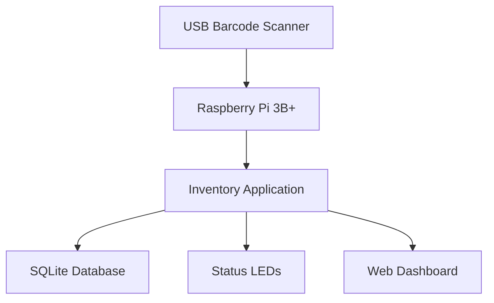

# Smart-Desk-Inventory-System
This is a smart inventory system that will be built around my desk that I will be working on to try and learn about electronics and CAD.

This Readme file will document my progress as I try to develop this idea

**STEP 1: Understanding My Goal and What I Need**

My goal for this project is to design and build a low-cost inventory management system for electronics labs using a Raspberry Pi, barcode scanner, and custom software.

To do this, I will need:
  - Raspberry PI 3b+
  - LEDs
  - 220 Ohm resistors
  - Barcode Scanner
  - Inventory Enclosure(3D Printed)
  - Jumper Wires

As the project continues to be developed, I will most likely update this list in order to accommodate for it.

**STEP 2: Planning System Layout**

In order to make the first Prototype of this project, I wil need to understand the basics of this project. 

I have used AI to make this diagram of how the original system is going to work: 

## Prototype System Architecture

STEP 3: Build the Minimum Viable Product

This will be my first attempt at making the prototype for this system.

I first, wrote a python script to get the bar code scanner's input and print it. I then added if statements to detect certain bar codes, that we can call "special codes". 

